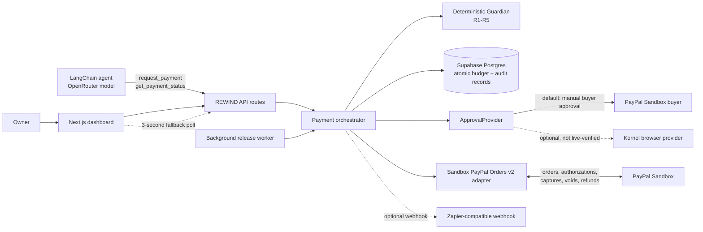

# REWIND

REWIND is a sandbox-only payment safety layer for AI-agent PayPal payments.
Owners define signed mandates; a deterministic Guardian checks each payment.
Payments are authorized first, held for an undo window, and captured only after that window.

## The problem

An agent can make a payment that is syntactically valid but still wrong: to the
wrong recipient, above the owner's limit, for a reused invoice, after a mandate
expires, or more than once. A mandate records prior intent, but by itself it
does not give the owner time to reconsider a particular payment after it has
been authorized.

REWIND combines standing limits with a reversible hold. The agent can request
payments and read status; the server alone performs PayPal authorization,
capture, void, and refund operations.

## Architecture



The domain types, state machine, and Guardian are in `domain/`. The provider
boundaries are in `paypal/`; persistence interfaces and Supabase code are in
`persistence/`. `lib/rewind/composition.ts` is the server composition root.
The LangChain agent has no direct PayPal adapter.

## End-to-end flow

1. The owner creates a USD mandate on `/rewind/mandates`. The server signs its
   canonical representation with HMAC-SHA256 and stores the signature and hash.
2. The agent calls `request_payment(mandateId, payeeEmail, amountCents,
   invoiceId)`. Amounts at API boundaries are integer cents.
3. Before any PayPal call, the server runs Guardian preflight. If it fails, it
   stores the rejected attempt, all five rule results, and an event; no budget
   is reserved and no order is created. R5 is explicitly deferred at this phase.
4. If preflight passes, `reserve_payment` atomically checks and reserves budget
   in Postgres. A duplicate invoice or a concurrent budget conflict becomes a
   rejected attempt. The server then creates an Orders v2 order with
   `intent=AUTHORIZE`, the payee, amount, and invoice ID.
5. The buyer approves the Sandbox order (manual approval is the default).
   The server authorizes it, reads the order and authorization back from
   PayPal, then runs Guardian again using observed PayPal data and histories
   that exclude this payment's own IDs.
6. If the second check fails, the server attempts to void and verify the
authorization. A verified void marks the payment rejected and releases
reserved budget; if the provider operation itself fails, the payment is
recorded as failed. If the check passes, the payment becomes `held` until
`release_at`.
7. During the hold, the owner can click **Undo**. The server claims the action
   with compare-and-set, voids the authorization, verifies PayPal reports
   `VOIDED`, and atomically releases the reservation.
8. When the hold expires, the worker (or dashboard fallback poll) claims the
   payment and captures it. A database transaction changes the status to
   `captured` and moves reserved budget to spent. Stale claims are reconciled
   against PayPal before a retry; capture calls use stable idempotency keys.
9. After capture, the owner may request a full **Refund**. This is a separate
   PayPal operation. The spent budget is restored only after PayPal confirms
   the refund as completed.

### Guardian rules

| Rule | Check |
|---|---|
| R1 — Payee | The payee email observed from PayPal matches the mandate, case-insensitively. |
| R2 — Amount and budget | Amount is positive, within the per-payment cap and remaining total budget, and currency matches (USD). |
| R3 — Invoice | Invoice ID is present and has not already been used under this mandate. |
| R4 — Mandate validity | Mandate is active and has not expired; revoked mandates cannot be used. |
| R5 — Replay | After authorization, PayPal order and authorization IDs are present, globally unprocessed, and still authorized. Preflight R5 is deferred until these IDs exist. |

### Undo is not refund

**Undo** is available only while a payment is held and still authorized. Voiding
the authorization is the pre-capture reversal: when PayPal confirms `VOIDED`,
the funds were never captured or sent to the recipient.

**Refund** is available only after capture. It is a new PayPal request to return
captured funds, and its outcome depends on PayPal and the recipient. REWIND does
not describe a refund as guaranteed.

## Setup

1. Clone the repository and enter the project:

   ```sh
   git clone https://github.com/KushalJain07/paypal-ai-hackathon.git
   cd paypal-ai-hackathon
   ```

2. Install dependencies:

   ```sh
   npm install
   ```

3. Copy the example environment file. `-n` avoids overwriting an existing local
   `.env`:

   ```sh
   if [ ! -e .env ]; then cp .env.example .env; fi
   ```

4. Create a Supabase project for Sandbox testing. In the Supabase project
   settings, obtain the project URL and server-side `service_role` key. Never
   expose that key to browser code or commit it.

5. In the Supabase SQL Editor, apply the migrations in this order:

   1. `supabase/migrations/202611120001_s2_persistence.sql`
   2. `supabase/migrations/202611120002_smoke_test_reservation.sql`
   3. `supabase/migrations/202611120003_s4_orchestrator.sql`
   4. `supabase/migrations/202611120004_s6_stale_claim_recovery.sql`

   After applying them, refresh PostgREST's schema cache in the SQL Editor:

   ```sql
   NOTIFY pgrst, 'reload schema';
   ```

6. Fill the required server-side values in `.env` using the table below. Keep
   `PAYPAL_BASE_URL` set to the Sandbox URL. Use one stable random signing
   secret of at least 32 characters; keep the same secret across app restarts
   and deployments so existing mandate signatures remain verifiable. Kernel is
   selected when its credentials are configured; manual approval is used when
   Kernel is absent or fails if `APPROVAL_FALLBACK_MANUAL=true`.

7. Start the web app and open the dashboard:

   ```sh
   npm run dev
   ```

   Visit `http://localhost:3000/rewind/mandates`. The dashboard includes
   mandates, payments, and a scenario simulator.

8. In a second terminal, start the background release worker:

   ```sh
   npm run worker
   ```

   The dashboard also polls `POST /api/rewind/worker/release` every three
   seconds as a fallback. Do not expose this unauthenticated prototype to
   untrusted users.

### Use the live payment agent

On `/rewind/simulator`, choose an active mandate, enter an amount in USD and an
invoice ID, then select **Ask agent to request payment**. This sends the
structured request to `/api/rewind/agent`; the LangChain/OpenRouter agent calls
the same REWIND payment-request API as the regular client. The server verifies
the agent's tool arguments match the submitted mandate, payee, amount, and
invoice before forwarding the request. The Guardian and Supabase reservation
remain authoritative. A passing request shows its Sandbox approval link and
can then be authorized; a rejected request shows the rule outcomes. The agent
does not have authorization, capture, undo, or refund tools.

The browser uses the real API and database by default; localStorage-backed mock
data is no longer selected by an environment flag. The agent requires
`OPENROUTER_API_KEY` and `OPENROUTER_MODEL`.

## Deploy on Render

1. Push this repository to a Git provider connected to your Render account.
2. In Render, choose **New → Blueprint**, select the repository, and deploy
   its `render.yaml`. The Blueprint creates the Next.js web service and the
   background release worker.
3. Before deploying, configure the prompted environment variables. Use the
   PayPal **Sandbox** app credentials and Sandbox base URL, the Supabase
   project URL and server-only service-role key, an OpenRouter API key/model,
   and a signing secret of at least 32 characters. Use the same
   `MANDATE_SIGNING_SECRET` for both services and retain it across redeploys.
4. To try automatic buyer approval, provide the Kernel API key, profile name,
   and Sandbox buyer credentials. `APPROVAL_PROVIDER=kernel` with
   `APPROVAL_FALLBACK_MANUAL=true` means a Kernel setup or browser failure
   falls back to the manual approval provider. Without Kernel credentials, the
   app uses manual approval.
5. Apply all four Supabase migrations and run `npm run supabase:smoke` before
   using the hosted app. The web service health check is
   `/api/rewind/health`; a healthy response includes `ok: true` and
   `pendingHeldCount`.
6. Open the Render web-service URL at `/rewind/mandates`. The separate worker
   releases payments automatically; the dashboard also polls
   `POST /api/rewind/worker/release` every three seconds as a fallback.

Do not expose the prototype to untrusted users: it does not yet authenticate
owners, and its payment APIs are not protected by user sessions.

## Environment variables

Do not paste credential values into documentation or client-side variables.
`.env.example` lists the configuration names; the sources below identify where
to obtain or choose them.

| Variable | Purpose | Where to get it / notes |
|---|---|---|
| `PAYPAL_CLIENT_ID` | Server-side PayPal REST app client ID. | Create or select an app in the PayPal Developer Dashboard's **Sandbox** environment. |
| `PAYPAL_CLIENT_SECRET` | Server-side PayPal REST app secret. | Same Sandbox REST app. Keep server-side only. |
| `PAYPAL_BASE_URL` | PayPal API endpoint; the adapter enforces the Sandbox endpoint. | PayPal Sandbox API configuration; live API endpoints are refused. |
| `PAYPAL_AUTOMATION_ENABLED` | Legacy Payouts code switch, unrelated to REWIND Orders. | Legacy setting only; do not enable it for REWIND setup. |
| `PAYPAL_SMOKE_PAYEE_EMAIL` | Default test recipient for PayPal smoke and Kernel approval scripts. | Email of a PayPal Sandbox business/payee account. |
| `APPROVAL_PROVIDER` | Selects the buyer approval provider. | Uses Kernel when configured; manual is the default when Kernel credentials are unavailable. |
| `APPROVAL_FALLBACK_MANUAL` | Controls fallback after Kernel setup, browser, or approval-poll errors. | Set to `true` to use the manual approval provider after an automatic failure. |
| `KERNEL_API_KEY` | Kernel browser API credential. | Kernel account/API settings; only needed for Kernel approval. |
| `KERNEL_PROFILE_NAME` | Persistent Sandbox buyer browser profile name. | Choose a profile name; the provider creates or loads it. |
| `SANDBOX_BUYER_EMAIL` | Buyer account used by the optional browser approval provider. | PayPal Sandbox personal/buyer account. |
| `SANDBOX_BUYER_PASSWORD` | Password for that Sandbox buyer account. | PayPal Sandbox account; server-side only. |
| `MANDATE_SIGNING_SECRET` | HMAC-SHA256 mandate signing key. | Generate a random secret locally that meets the documented minimum length. |
| `SUPABASE_URL` | REWIND database endpoint. | Supabase project settings / API. |
| `SUPABASE_SERVICE_ROLE_KEY` | Server-side database access for the REWIND persistence adapter and scripts. | Supabase project API settings; use the service-role secret, never the anon/public key. |
| `OPENROUTER_API_KEY` | Authenticates the LangChain model client. | OpenRouter account API keys. |
| `OPENROUTER_MODEL` | Model identifier used by the agent. | Choose a model identifier available in the OpenRouter catalog. |
| `REWIND_API_BASE_URL` | Optional base URL for the standalone agent CLI's HTTP client. | Defaults to local development; the dashboard agent route uses the incoming service URL / Render's external URL. |
| `WORKER_INTERVAL_MS` | Worker loop interval in milliseconds. | Optional worker timing configuration. |
| `STALE_CLAIM_SECONDS` | Age after which an abandoned release claim can be reconciled. | Optional stale-claim threshold configuration. |
| `ZAPIER_WEBHOOK_URL` | Optional HTTPS webhook for payment event summaries. | Create a Zapier Catch Hook URL; leave unset to disable notifications. |
| *(no receipt variable)* | Receipt signing, storage, and verification are not implemented. | There is no receipt configuration to obtain. |

## Tests and operational scripts

Run the local checks:

```sh
npm test
npm run lint
npm run typecheck
npm run build
```

`npm test` uses fakes/mocked HTTP and does not require live PayPal or Supabase
access. It includes the agent-boundary test that rejects direct PayPal or
privileged payment operations in `src/`.

### Supabase persistence smoke test

After applying all migrations, run:

```sh
npm run supabase:smoke
```

It calls the `smoke_test_reservation` RPC with the server-only service-role key.
The RPC creates test rows inside a subtransaction and rolls them back after
checking readback, duplicate-invoice rejection, and over-budget rejection.
This tests the configured project, not just the local fake. Do not run against
a project where migration `202611120002` has not been applied.

### End-to-end Sandbox scenarios

The E2E script connects directly to Supabase and the PayPal Sandbox adapter.
It writes persistent mandate/payment records to Supabase. Run one scenario at a
time with Sandbox credentials and a Sandbox payee:

```sh
npm run e2e -- valid-capture --payee-email <sandbox-payee-email>
```

Replace `valid-capture` with `undo`, `refund`, `wrong-payee`, `over-cap`,
`reused-invoice`, or `expired-mandate` to run the corresponding scenario.
Valid-capture, undo, and refund require manual buyer approval and create real
Sandbox transactions. The reused-invoice scenario creates one first request
(and therefore one Sandbox order) before checking that a duplicate request
does not create another order. Use an isolated test project and account.

### PayPal adapter smoke test

```sh
npm run paypal:smoke -- --payee-email <sandbox-payee-email>
```

This creates two Sandbox orders, manually waits for buyer approval, captures
and refunds the first authorization, then voids the second and verifies the
authorization by reading it back. It does not delete PayPal Sandbox
transactions. Capture responses that are ambiguous are recovered by capture
lookup or authorization readback; a retry uses the same PayPal idempotency key.
A `PENDING` capture is reported as pending and is not refunded until completed.

### Agent

The LangChain agent exposes only `request_payment` and `get_payment_status`.
The dashboard's **Ask agent to request payment** action invokes it through
`/api/rewind/agent`; the backend rejects invalid cents and prevents the model
from changing the submitted mandate, payee, amount, or invoice. The standalone
`npm run demo:agent -- "..."` command uses the same agent implementation and
needs a reachable API URL in `REWIND_API_BASE_URL`.

## Sandbox buyer approval

Manual approval prints the PayPal Sandbox approval link and polls the Orders
API until the order status is `APPROVED`; it does not infer approval from
checkout page text. The standalone smoke and E2E scripts use this path.

An optional `KernelApprovalProvider` opens a Kernel browser profile and
interacts with the PayPal Sandbox checkout. Success is still determined by the
PayPal Orders API reporting `APPROVED`. If Kernel configuration, browser
automation, or approval polling fails and `APPROVAL_FALLBACK_MANUAL=true`, the
manual provider prints the Sandbox approval link and continues polling. Do not
bypass PayPal captcha, bot checks, or 2FA.

## Sponsor tools and integration status

- **AG Grid:** used for the payments table in the REWIND dashboard.
- **Supabase:** Postgres persistence with atomic reservations and transactional
  payment/budget transitions. The repository has an RPC smoke test; run it
  against your own configured project before relying on a deployment.
- **OpenRouter:** used by the LangChain payment agent; requires an API key and
  model identifier.
- **Kernel:** optional browser approval provider exists and has mocked tests,
  but has not been verified against a live Kernel session.
- **Render:** `render.yaml` defines a web service and background worker. This
  repository does not establish that a live Render deployment is running. The
  Blueprint does not list OpenRouter or Kernel variables; configure those
  separately if the deployed agent or Kernel provider is needed.
- **Zapier:** optional best-effort HTTPS webhook notifier exists. A live Zap
  is not configured by the repository.
- **Postman/OpenAPI:** no Postman collection or OpenAPI specification is
  included.

## Project structure

| Path | Responsibility |
|---|---|
| `app/rewind/` | Mandate, payment, and simulator dashboard pages. |
| `app/api/rewind/` | Thin Next.js route handlers for mandates, payments, agent requests, health, and worker release. |
| `components/rewind/` | Dashboard shell and typed real API client. |
| `domain/` | Validated mandate/payment types, state machine, Guardian rules, and decision schema. |
| `orchestrator/` | Payment lifecycle, mandate signing, status transitions, recovery, and owner actions. |
| `paypal/` | Sandbox Orders v2 adapter and manual/Kernel approval providers. |
| `persistence/` | Repository contracts, in-memory test persistence, and Supabase implementation. |
| `supabase/migrations/` | Ordered schema, smoke RPC, orchestrator transactions, and stale-claim recovery. |
| `src/agent/` | LangChain/OpenRouter agent with only `request_payment` and `get_payment_status`. |
| `src/api/` | Agent's HTTP client for the REWIND API. |
| `scripts/` | Worker, E2E, smoke, and agent demo entry points. |
| `notifications/` | Optional webhook notifier. |
| `tests/` | Domain, persistence, provider, orchestrator, API, worker, and notification tests. |
| `docs/` | Product requirements, spike notes, Kernel notes, demo script, and project description. |
| `lib/payments.ts`, `app/api/payments/` | Legacy Payouts prototype, separate from REWIND Orders flow. |

## Known limitations

- **Sandbox only.** The PayPal adapter rejects a non-Sandbox API base URL.
- **No user authentication or authorization.** Do not expose this prototype's
  owner or payment APIs to untrusted users.
- **Kernel approval is experimental.** Use manual approval fallback and
  confirm the first order in the configured Sandbox account.
- **Dashboard worker polling is a fallback.** A separate background worker is
  configured in `render.yaml`; live Render deployment has not been verified.
- **Refund is not guaranteed.** It is a post-capture request whose completion
  depends on PayPal and the recipient.
- **Receipts are not implemented.** There is no receipt endpoint, signed
  receipt format, or receipt verification UI/configuration.
- **No Postman/OpenAPI deliverable is present.**
- **Zapier credentials are not provisioned.** Its integration
  code does not establish a live service configuration.
- **Legacy Payouts code remains.** `PAYPAL_AUTOMATION_ENABLED` controls that
  separate prototype, not REWIND's Orders v2 flow.
